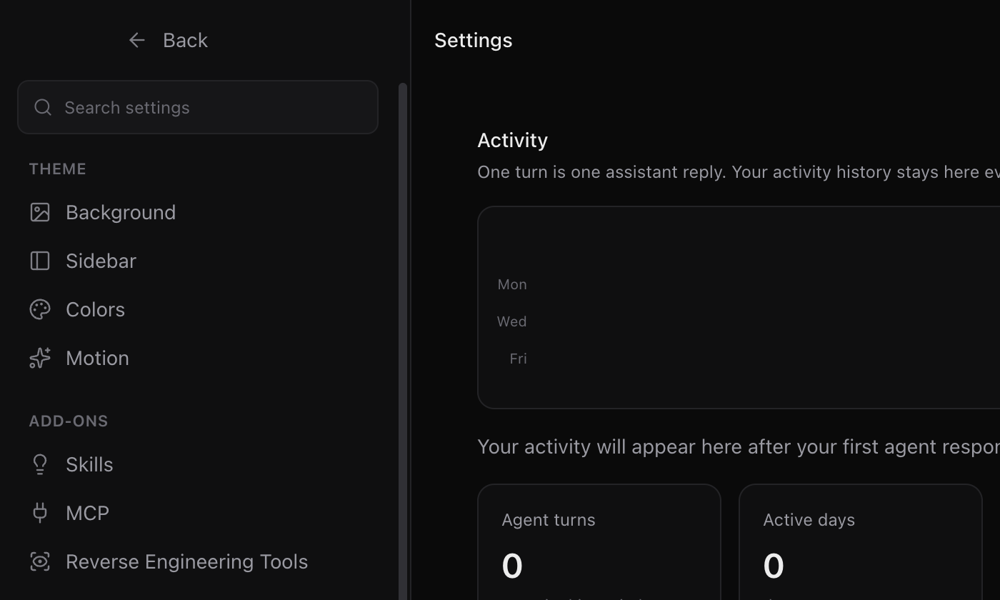
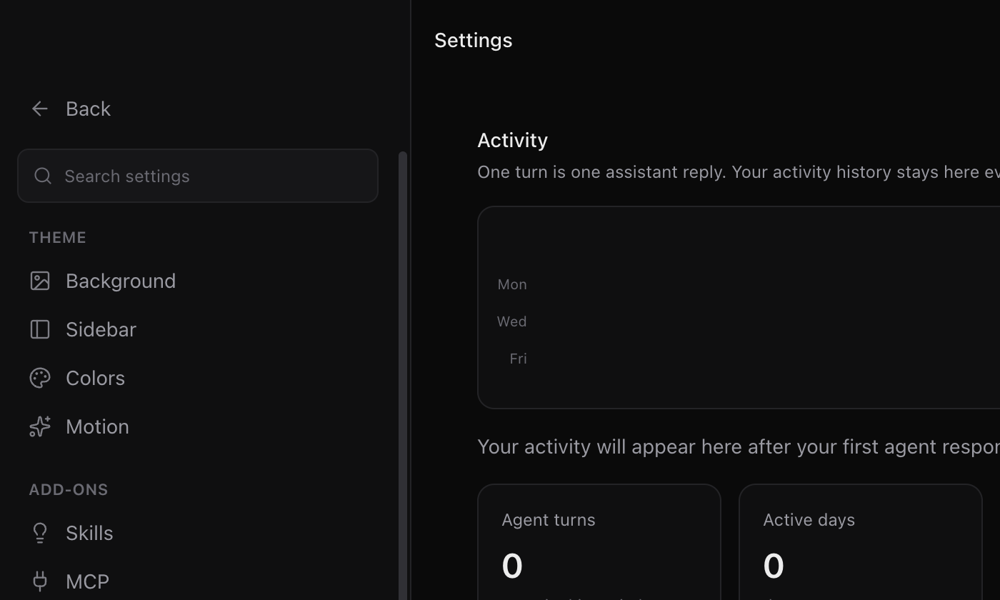
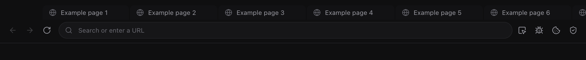
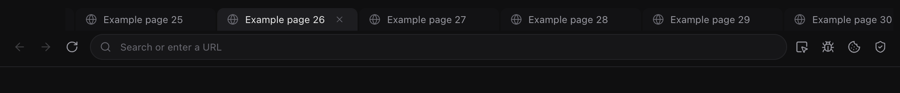
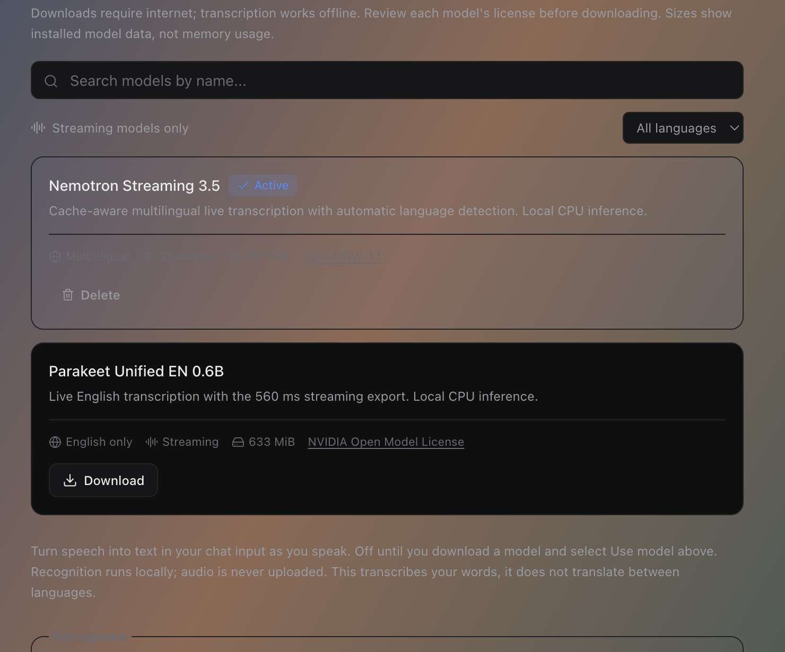
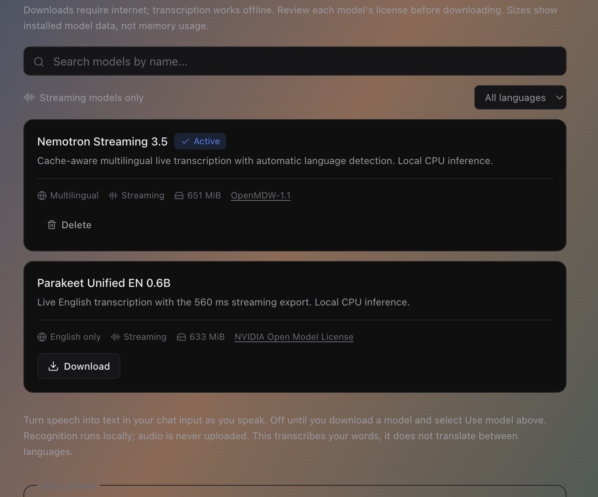

# Visual Fix Comparisons

Electron renderer captures using isolated canvas fixtures, not personal chats or account data.
Before captures render the affected files from base commit `2dc5983`; after captures render this PR.
Both versions use the same fixture data, window dimensions and macOS layout.
Native traffic lights are outside `webContents.capturePage` and are not included in these images.

## Settings Navigation

| Before                                                                       | After                                                                              |
| ---------------------------------------------------------------------------- | ---------------------------------------------------------------------------------- |
|  |  |

## Scrolled Browser Tabs

| Before                                                                     | After                                                                                   |
| -------------------------------------------------------------------------- | --------------------------------------------------------------------------------------- |
|  |  |

## Selected Voice Model

| Before                                                                                             | After                                                                                     |
| -------------------------------------------------------------------------------------------------- | ----------------------------------------------------------------------------------------- |
|  |  |
